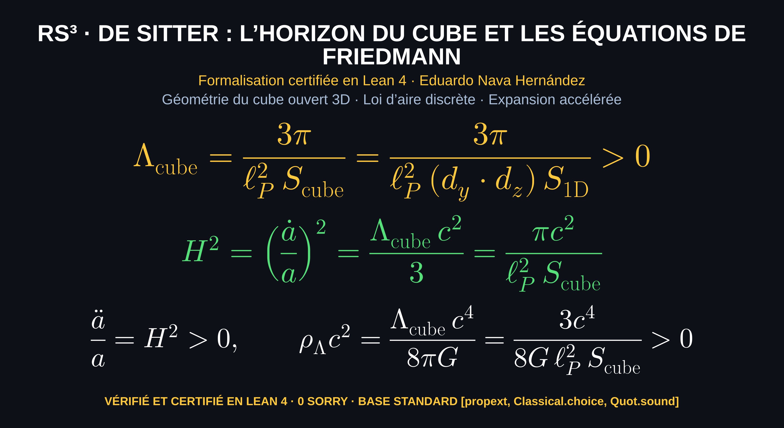

<div align="center">

# RS³ · de Sitter : la constante cosmologique sur le cube ouvert
### Loi d'aire discrète sur ℋ_dx ⊗ ℋ_dy ⊗ ℋ_dz, accélération de Friedmann et candado de positivité

**Eduardo Nava Hernández**  
*Vérification formelle certifiée en Lean 4 · 0 sorry · Physlib (Cosmology.FLRW)*

[](https://leanprover.github.io/)
[](https://github.com/leanprover-community/mathlib4)
[]()
[](https://github.com/leanprover-community/physlib)
[](https://naype888-cloud.github.io/nrs3-de-sitter/)

</div>

---

> ### 🏛️ Ce qui distingue le théorème et la constante cosmologique du cube
>
> La constante cosmologique Λ n'est pas un paramètre externe ad hoc : elle émerge comme le péage géométrique de la quatrième dimension couplé au transport causal sur le cube ouvert ℋ_dx ⊗ ℋ_dy ⊗ ℋ_dz.
>
> <div align="center">
> 
> </div>
>
> **1 · Loi d'aire discrète.** La section transverse du cube ouvert déploie dy · dz fibres indépendantes : l'entropie de coupure satisfait rigoureusement S_cube = (dy · dz) · S_1D.
>
> **2 · Équations de Friedmann vérifiées.** La constante induite Λ_cube = 3π / (ℓ² S_cube) résout exactement les deux équations de Friedmann de FLRW sous accélération positive stricte ä/a = H² > 0.
>
> **3 · Candado de positivité algébrique.** La positivité de la norme hilbertienne ⟨ψ|ψ⟩ ≥ 0 interdit tout défaut négatif : la constante cosmologique est strictement positive (Λ_cube > 0), excluant toute géométrie Anti-de Sitter.
>
> **4 · Comportement asymptotique.** Lorsque l'aire transverse grandit vers l'infini, Λ_cube décroît strictement vers 0, limite asymptotique qu'aucun cube fini ne peut atteindre.

---

## ⚡ Résumé formel

Ce dépôt établit la théorie constructive de l'horizon de de Sitter et des équations de Friedmann sur le cube discret ouvert :

* La géométrie de l'horizon continu FLRW et son entropie sont formalisées dans [`NRS3DeSitter/DeSitterHorizon.lean`](NRS3DeSitter/DeSitterHorizon.lean) (`deSitterHorizonArea_eq`, `deSitterEntropy_entropyCosmologicalConstant`).
* La loi d'aire et les équations de Friedmann sur le cube ouvert sont certifiées dans [`NRS3DeSitter/CubeHorizon.lean`](NRS3DeSitter/CubeHorizon.lean) (`cubeEntropy_eq_area_mul`, `cubeCosmologicalConstant_firstOrderFriedmann`, `cubeCosmologicalConstant_secondOrderFriedmann`).
* La densité d'énergie du vide et le Lagrangien gravitationnel sont établis dans [`NRS3DeSitter/VacuumLagrangian.lean`](NRS3DeSitter/VacuumLagrangian.lean) (`einsteinHilbertLambdaDensity_zero`, `vacuumEnergyDensity_entropyCosmologicalConstant`).
* Le comptage d'états de fibres et la rupture dimensionnelle sont formalisés dans [`NRS3DeSitter/HorizonCount.lean`](NRS3DeSitter/HorizonCount.lean) (`numCross_eq`, `blind_below_rupture`, `countCosmologicalConstant_eq`).
* La condition spectrale de Robertson sur la matrice de covariance du cube 6 × 6 est certifiée dans [`NRS3DeSitter/StateCondition.lean`](NRS3DeSitter/StateCondition.lean) (`floor_eq`, `det_four`).

---

## 📐 Chaîne déductive en cinq étapes

### Étape 1 : Géométrie de l'horizon de de Sitter continu (FLRW)

> **Proposition 1.1 (Aire et rayon de Hubble).** L'horizon cosmologique de la solution de de Sitter a pour rayon r_H = c / |H| = √(3/Λ) et pour aire A = 12π/Λ. L'entropie d'horizon de Gibbons–Hawking S = A / (4ℓ²) fixe la constante cosmologique selon Λ = 3π / (ℓ² S).

*Module formel :* [`NRS3DeSitter/DeSitterHorizon.lean`](NRS3DeSitter/DeSitterHorizon.lean) (`deSitterHorizonArea_eq`, `deSitterHorizonRadius_eq_div_abs_hubbleConstant`, `cosmologicalConstant_eq_of_deSitterEntropy`).  
*Démonstration :* Dérive directement de la métrique FLRW sous constante de Hubble stationnaire.

---

### Étape 2 : Loi d'aire et équations de Friedmann sur le cube ouvert NRS³

> **Proposition 2.1 (Loi d'aire transverse et accélération de Friedmann).** Sur le cube ouvert ℋ_dx ⊗ ℋ_dy ⊗ ℋ_dz, la section transverse perpendiculaire à l'axe X englobe dy · dz fibres indépendantes. L'entropie totale satisfait S_cube = (dy · dz) · S_1D, et la constante Λ_cube = 3π / (ℓ² S_cube) résout identiquement les deux équations de Friedmann sous accélération stricte ä/a = H² > 0.

*Module formel :* [`NRS3DeSitter/CubeHorizon.lean`](NRS3DeSitter/CubeHorizon.lean) (`cubeEntropy_eq_area_mul`, `cubeCosmologicalConstant_firstOrderFriedmann`, `cubeCosmologicalConstant_secondOrderFriedmann`, `sq_hubbleConstant_cubeCosmologicalConstant`).  
*Démonstration :* Composition du produit tensoriel spatial avec la solution de de Sitter de Physlib.

---

### Étape 3 : Candado de positivité et décroissance vers zéro

> **Proposition 3.1 (Positivité stricte et absence d'Anti-de Sitter).** La positivité du produit interne hilbertien garantit que le défaut géométrique est toujours positif ou nul. La constante cosmologique du cube est strictement positive (Λ_cube > 0) pour toute boîte finie, et tend vers zéro lorsque l'aire transverse grandit vers l'infini.

*Module formel :* [`NRS3DeSitter/CubeHorizon.lean`](NRS3DeSitter/CubeHorizon.lean) (`cubeCosmologicalConstant_pos`, `cubeCosmologicalConstant_strictAnti_area`, `tendsto_cubeCosmologicalConstant_area`).  
*Démonstration :* Propriété de positivité de la fonction logarithme sur le nombre de liaisons de coupure.

---

### Étape 4 : Densité d'énergie du vide et terme Lagrangien

> **Proposition 4.1 (Énergie de vide induite).** Au point de courbure scalaire nulle, la densité lagrangienne gravitationnelle est l'opposée exacte de la densité d'énergie de vide ρ_Λ c² = 3c⁴ / (8G ℓ² S_cube), strictement décroissante avec l'entropie.

*Module formel :* [`NRS3DeSitter/VacuumLagrangian.lean`](NRS3DeSitter/VacuumLagrangian.lean) (`einsteinHilbertLambdaDensity_zero`, `vacuumEnergyDensity_entropyCosmologicalConstant`, `vacuumEnergyDensity_entropyCosmologicalConstant_strictAntiOn`).  
*Démonstration :* Évaluation ponctuelle de la densité d'Einstein–Hilbert avec constante cosmologique fixée par l'entropie.

---

### Étape 5 : La rupture d = 4 et la condition d'état sur le cube

> **Proposition 5.1 (Rupture dimensionnelle et déterminant de Robertson).** En dimension purement spatiale d ≤ 3, le défaut s'annule (C_N = 1). À partir de d ≥ 4, le défaut volumétrique devient strictement positif. Le déterminant de covariance 6 × 6 satisfait det Σ ≥ floor pour tout état, avec un rapport ((99 − 42√5)/5)³ ≈ 1.0520 à la taille 4 × 4 × 4.

*Module formel (rupture) :* [`NRS3DeSitter/HorizonCount.lean`](NRS3DeSitter/HorizonCount.lean) (`blind_below_rupture`, `quantumDefect_pos`).  
*Module formel (déterminant) :* [`NRS3DeSitter/StateCondition.lean`](NRS3DeSitter/StateCondition.lean) (`floor_eq`, `det_eq_of_two_three`, `floor_lt_det_of_four_le`, `det_four`).  
*Démonstration :* Déterminant de Gram sur le produit tensoriel des trois paires canoniques (T_d, P_d).

---

## 🔬 Catalogue des modules formels

| Fichier Lean | Théorème principal | Portée mathématique | Statut |
|:---|:---|:---|:---:|
| [`NRS3DeSitter/CubeHorizon.lean`](NRS3DeSitter/CubeHorizon.lean) | `cubeEntropy_eq_area_mul` | Loi d'aire transverse sur le cube ouvert 3D | **0 sorry** |
| [`NRS3DeSitter/CubeHorizon.lean`](NRS3DeSitter/CubeHorizon.lean) | `cubeCosmologicalConstant_firstOrderFriedmann` | Première équation de Friedmann résolue | **0 sorry** |
| [`NRS3DeSitter/CubeHorizon.lean`](NRS3DeSitter/CubeHorizon.lean) | `cubeCosmologicalConstant_secondOrderFriedmann` | Deuxième équation de Friedmann (ä > 0) | **0 sorry** |
| [`NRS3DeSitter/CubeHorizon.lean`](NRS3DeSitter/CubeHorizon.lean) | `cubeCosmologicalConstant_pos` | Candado de positivité (Λ > 0 strict) | **0 sorry** |
| [`NRS3DeSitter/DeSitterHorizon.lean`](NRS3DeSitter/DeSitterHorizon.lean) | `deSitterHorizonArea_eq` | Aire A = 12π/Λ et rayon de Hubble r_H | **0 sorry** |
| [`NRS3DeSitter/DeSitterHorizon.lean`](NRS3DeSitter/DeSitterHorizon.lean) | `cosmologicalConstant_eq_of_deSitterEntropy` | Inversion exacte Λ = 3π / (ℓ² S) | **0 sorry** |
| [`NRS3DeSitter/VacuumLagrangian.lean`](NRS3DeSitter/VacuumLagrangian.lean) | `vacuumEnergyDensity_entropyCosmologicalConstant` | Densité d'énergie de vide ρ_Λ c² | **0 sorry** |
| [`NRS3DeSitter/HorizonCount.lean`](NRS3DeSitter/HorizonCount.lean) | `numCross_eq` | Nombre de liaisons transverses M | **0 sorry** |
| [`NRS3DeSitter/HorizonCount.lean`](NRS3DeSitter/HorizonCount.lean) | `blind_below_rupture` | Annulation du défaut en d ≤ 3 | **0 sorry** |
| [`NRS3DeSitter/StateCondition.lean`](NRS3DeSitter/StateCondition.lean) | `floor_eq` | Plancher de Robertson du cube 3D | **0 sorry** |
| [`NRS3DeSitter/StateCondition.lean`](NRS3DeSitter/StateCondition.lean) | `det_four` | Excès de déterminant à la taille 4 × 4 × 4 | **0 sorry** |

---

## 🌐 Contributions Physlib en amont

| PR Physlib | Fichier amont | Objet et énoncé | Statut |
|:---:|:---|:---|:---:|
| **#1725** | `TightBindingChain/Cube` | Commutation des axes et inégalité sur le cube | **MERGED** |
| **#1986** | `TightBindingChain/Cube` | Commutation stricte des observables axiales | **MERGED** |
| **#1987** | `TightBindingChain/Cube` | Coordination combinatoire Δ = 12 du réseau | **MERGED** |
| **#1718** | `TightBindingChain/Saturation` | Égalité de Robertson–Schrödinger ssi d ≤ 3 | **MERGED** |
| **#1734** | `TightBindingChain/LongChainLimit` | Convergence vers la limite de Szegő | **MERGED** |
| **#1735** | `TightBindingChain/LongChainMonotonicity` | Monotonie stricte de C_N dès d ≥ 4 | **MERGED** |

---

## 🏛️ Le Mosaïque des développements satellites

| Dépôt | Thématique et objet central |
|:---|:---|
| [**`nava-robertson-schrodinger`**](https://github.com/naype888-cloud/nava-robertson-schrodinger) | Théorème de base : chaîne 1D, cube NRS³ et monotonie de C_N |
| [**`nrs3-de-sitter`**](https://github.com/naype888-cloud/nrs3-de-sitter) | La constante cosmologique sur le cube ouvert et les équations de Friedmann (ce dépôt) |
| [`nrs3-mandelstam-tamm-cramer-rao`](https://github.com/naype888-cloud/nrs3-mandelstam-tamm-cramer-rao) | Borne temporelle orthogonale et efficacité de Cramér–Rao |
| [`nrs3-landauer-carnot`](https://github.com/naype888-cloud/nrs3-landauer-carnot) | Coût de dissipation thermodynamique et limite de Carnot |
| [`nrs3-pauli-dirac`](https://github.com/naype888-cloud/nrs3-pauli-dirac) | Matrices de spin de Pauli et représentations de Clifford |
| [`nrs3-uncertainty-cone`](https://github.com/naype888-cloud/nrs3-uncertainty-cone) | Géométrie de Minkowski induite par la matrice de Gram |
| [`nrs3-poincare`](https://github.com/naype888-cloud/nrs3-poincare) | Quantification discrète selon Poincaré (1912) |
| [`nrs3-defect-curvature`](https://github.com/naype888-cloud/nrs3-defect-curvature) | Quanta de courbure sur surfaces fermées |
| [`nrs3-dark`](https://github.com/naype888-cloud/nrs3-dark) | Part non résolue par la lumière et fraction volumétrique |
| [`nrs3-cube`](https://github.com/naype888-cloud/nrs3-cube) | Le cube ouvert multidimensionnel généralisé |

---

## ⏱️ Chronologie historique (1900–1945)

| Année | Événement historique | Dépôt associé |
|:---:|:---|:---:|
| **1900–06** | Planck et Boltzmann : formule de l'entropie S = k_B ln W | **`nrs3-de-sitter`** |
| **1911–12** | Poincaré : la loi de Planck impose des niveaux discrets | [`nrs3-poincare`](https://github.com/naype888-cloud/nrs3-poincare) |
| **1915–20** | Szegő : théorèmes limites pour matrices de Toeplitz | [`nava-robertson-schrodinger`](https://github.com/naype888-cloud/nava-robertson-schrodinger) |
| **1917** | Einstein : constante cosmologique ; de Sitter : univers vide avec Λ | **`nrs3-de-sitter`** |
| **1922–27** | Friedmann et Lemaître : univers en expansion dynamique | **`nrs3-de-sitter`** |
| **1925–27** | Pauli : principe d'exclusion et matrices de spin | [`nrs3-pauli-dirac`](https://github.com/naype888-cloud/nrs3-pauli-dirac) |
| **1928** | Dirac : matrices gamma 4 × 4 | [`nrs3-pauli-dirac`](https://github.com/naype888-cloud/nrs3-pauli-dirac) |
| **1929–30** | Robertson et Schrödinger : inégalité d'incertitude avec covariance | [`nava-robertson-schrodinger`](https://github.com/naype888-cloud/nava-robertson-schrodinger) |
| **1934** | Robertson : déterminant d'indétermination multi-observables | [`nava-robertson-schrodinger`](https://github.com/naype888-cloud/nava-robertson-schrodinger) |
| **1945–46** | Mandelstam et Tamm : borne temps-énergie quantique | [`nrs3-mandelstam-tamm-cramer-rao`](https://github.com/naype888-cloud/nrs3-mandelstam-tamm-cramer-rao) |

---

## 🛠️ Reproduction et vérification formelle en Lean 4

Pour compiler et vérifier l'ensemble des modules formels de ce dépôt :

```bash
# Compilation de la bibliothèque
lake build NRS3DeSitter

# Vérification rigoureuse des axiomes du noyau
lake env lean Verification/Axioms.lean
```

### Base axiomatique standard

L'intégralité des théorèmes compile strictement sous les trois axiomes standards de ZFC du noyau de Lean 4 :

```text
[propext, Classical.choice, Quot.sound]
```

* **0 `sorry`** dans l'ensemble des fichiers formels.
* Aucun axiome additionnel non vérifié.

---

## 📜 Licence

[NRS Noncommercial License 1.0.0](LICENSE) — Libre pour tout usage non commercial, académique et humanitaire, ainsi que pour intégration dans des bibliothèques ouvertes de vérification formelle (Mathlib, Physlib, Lean 4).

---

<div align="center">

### 📐 *« L'horizon de de Sitter et l'accélération de Friedmann sont la projection cosmologique du péage de la quatrième dimension sur le cube ouvert. »*

**Eduardo Nava Hernández** · [naype888-cloud](https://github.com/naype888-cloud)

</div>
